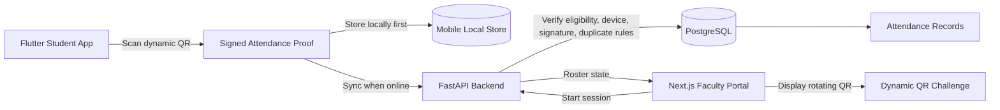
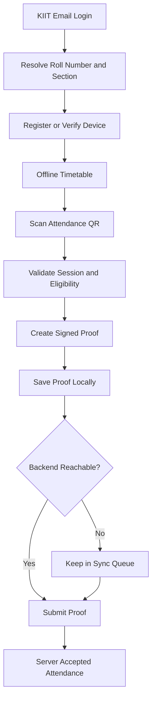
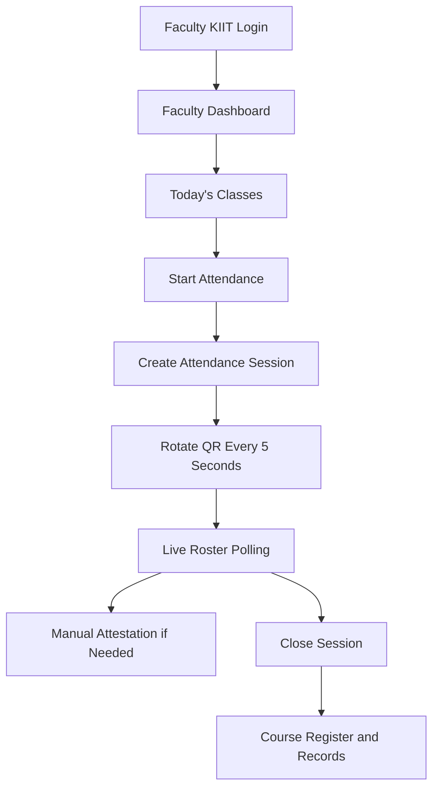
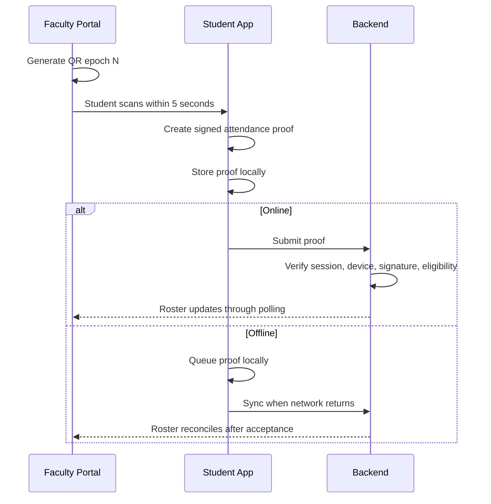
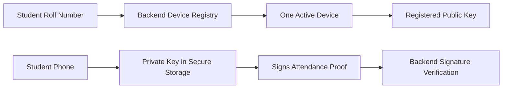

<div align="center">

# KIIT Attendance System

### Offline-first secure dynamic QR attendance platform for classrooms


</div>

## Project Summary

KIIT Attendance System is a minor project prototype for a secure, offline-first classroom attendance platform. The system is built around a simple requirement: attendance must continue even when the classroom internet connection fails.

The platform combines a Flutter student app, a Next.js faculty portal, and a FastAPI backend. Attendance is captured locally first, cryptographically signed by the registered student device, synchronized when the network returns, and re-verified by the backend before becoming authoritative.

## Core Capabilities

- Dynamic classroom QR codes that rotate every 5 seconds.
- A 60-second scanned-claim window after a valid QR scan.
- One active registered device per student.
- Ed25519 device signatures for attendance proofs.
- Offline-first mobile capture with local proof history.
- Faculty live attendance portal with QR hosting and roster polling.
- Manual faculty attestation for controlled fallback.
- Course, section, roster, session, and attendance reconciliation.
- Student-facing timetable, attendance summary, scanner, and KIIT portal shortcuts.

## System Architecture



## Student App Flow



## Faculty Portal Flow



## Dynamic QR Protocol

Each attendance QR contains a protected classroom challenge. The QR changes every 5 seconds, making screenshots short-lived. If a student scans during a valid 5-second epoch, the app receives a claim window of approximately 60 seconds to complete local proof creation and synchronization.



## Device Security Model

The system does not depend on MAC address, public IP, IMEI, or browser fingerprinting. During enrollment, the mobile app creates a cryptographic device identity. The private credential stays on the phone, and the backend stores the public credential against the student.



## Offline-First Principle

Attendance capture follows this order:

1. Capture QR inside the student app.
2. Validate session, course, and section locally where possible.
3. Create a signed proof on the registered device.
4. Store the proof locally.
5. Update the student UI immediately.
6. Poll for network availability.
7. Push the proof to the backend as soon as it is reachable.
8. Re-verify centrally and update the faculty roster.

## Repository Structure

```text
backend/
  app/                 FastAPI domain, device, attendance, sync, and presence modules
  migrations/          PostgreSQL schema migrations
  seeds/               Demo academic data
  tests/               Backend protocol and reconciliation tests

client/
  lib/                 Flutter student app
  android/             Android host project
  ios/                 iOS host project
  web/                 Flutter web assets
  test/                Flutter protocol and UI tests

faculty-portal/
  src/app/             Next.js App Router pages
  src/components/      Faculty portal UI and live attendance components
  src/lib/             Shared formatting and UI helpers
  src/protocol.ts      Dynamic QR signing payload generation
```

## Run Locally

### Backend

```bash
cd backend
uvicorn app.main:app --reload --host 127.0.0.1 --port 8000
```

### Faculty Portal

```bash
cd faculty-portal
npm install
npm run dev
```

Open `http://127.0.0.1:5173/dashboard`.

### Student App

```bash
cd client
flutter pub get
flutter run
```

## Demo Accounts

Faculty portal:

- Email: `dr.ajit.kumar.pasayat@kiit.ac.in`
- Password: `admin`

Student demo:

- Roll number: `24155866`
- Section: `CS21`

## Technology Stack

- Flutter and Dart for the student mobile app.
- Next.js App Router and React for the faculty portal.
- FastAPI and Python for the backend API.
- PostgreSQL schema design through SQL migrations.
- Ed25519 signatures for device-bound attendance proofs.
- Local client storage for offline-first capture and synchronization queues.

## Security Position

The platform is designed to be proxy-resistant, tamper-evident, offline-capable, auditable, and device-bound. It is not described as mathematically impossible to bypass, because physical collusion can never be fully eliminated by software alone. The engineering goal is to substantially reduce practical attacks such as roll-number proxy, old QR replay, multiple-device abuse, offline tampering, and wrong-section attendance.
