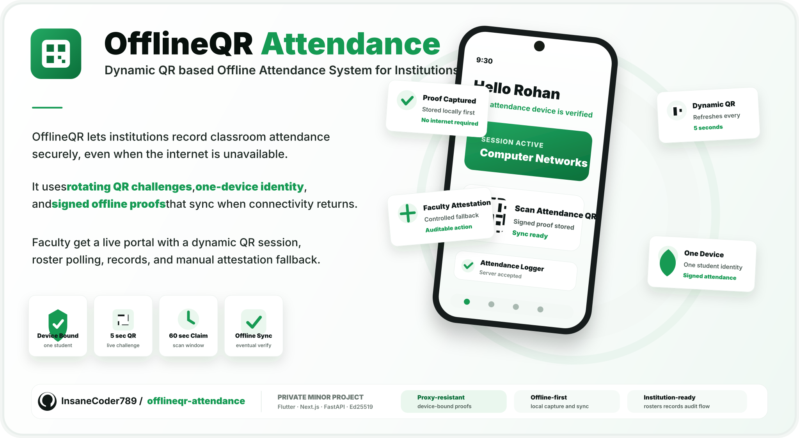
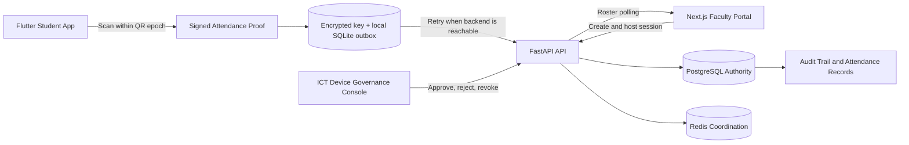
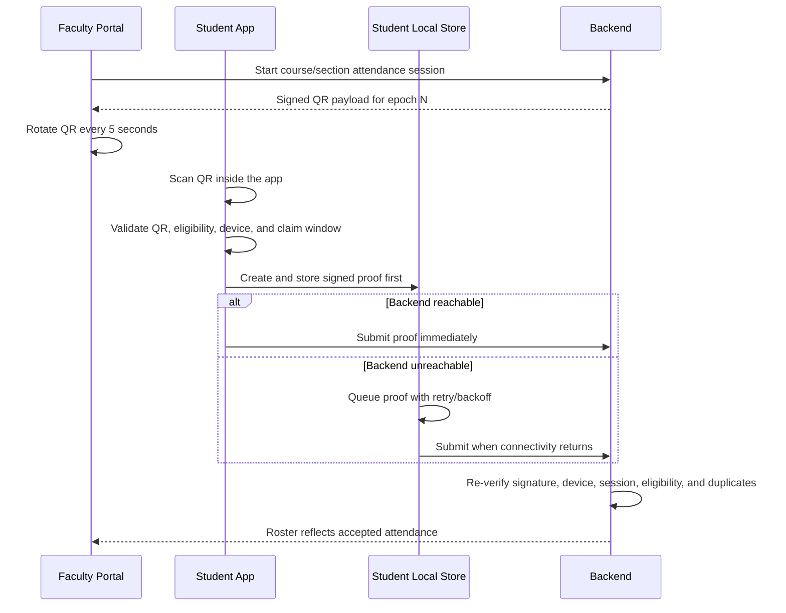
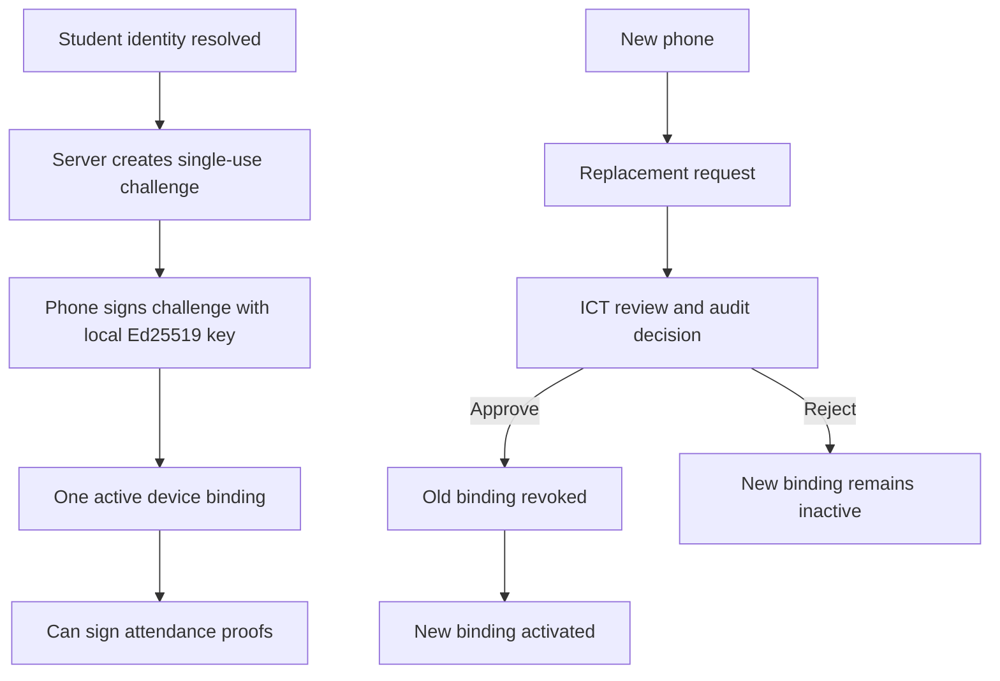

<div align="center">



# OfflineQR Attendance

### Dynamic QR Based Offline Attendance System for Institutions


</div>

## Overview

OfflineQR Attendance is an offline-first classroom attendance platform. It combines a Flutter student app, a Next.js faculty portal, an ICT device-governance console, and a FastAPI/PostgreSQL/Redis backend.

The operating principle is simple: **capture locally, sign cryptographically, store durably, synchronize when reachable, and verify centrally.** Internet connectivity improves reconciliation and reporting, but it is not required for a student device to capture a valid attendance proof.

## Delivery Status

### Implemented and Verified

- Flutter student experience: KIIT-email development login, timetable, attendance summary, in-app scanner, attendance logger, device status, and KIIT portal shortcuts.
- Dynamic attendance sessions: faculty starts a course/section session, the QR payload rotates every 5 seconds, and each valid scan receives a 60-second proof-creation window.
- Signed proof pipeline: Ed25519 device identity, signed attendance proof, local SQLite outbox, retry/backoff, batch synchronization, idempotency, reconciliation, and faculty roster polling.
- Device binding and governance: one active device per student, challenge-response enrollment, revocation, audited replacement requests, ICT approval/rejection, device history, and emulator-declaration rejection.
- Faculty identity: `@kiit.ac.in` accounts use Argon2id password hashes, server-owned HTTP-only sessions, CSRF validation, login lockout, forced first-password change, and editable name/phone profile fields.
- Faculty portal: dedicated Next.js pages for login, dashboard, classes, live attendance, records, settings, projector mode, and ICT device governance.
- Redis coordination: shared request limits, device-challenge throttling, opaque faculty-session storage, and attendance-session update publication across API workers.
- Faculty provisioning: the restricted local onboarding register imports the validated staff identities, designation, and organisational unit; the official assignment/timetable import remains intentionally blocked on source data.
- Controlled fallback: faculty manual attestation records the reason and attendance method separately from normal QR capture.
- Quality gates: backend protocol/database tests, Flutter static and unit tests, faculty portal tests/build/audit, and backend/faculty Docker image builds.

### Deferred Until Official Academic Data Is Available

- Faculty initialization and real per-faculty class access. This needs an authoritative import covering faculty identity, course offering, section, room, timetable, and enrolled-student roster.
- Student/faculty provisioning from KIIT systems rather than the present demonstration seed data.

## Architecture



## Attendance Protocol



### QR and Claim Rules

- A faculty session produces a signed QR challenge every 5 seconds.
- A QR must be scanned during its short epoch; stale screenshots are rejected.
- A successful scan opens a bounded 60-second claim window for signing and durable local capture.
- The student app records the QR data and signature locally before attempting transport.
- The backend enforces one academic attendance record per `(session, student)` and one device representation per session.
- QR payload timestamps use one canonical UTC representation, preventing signature failures caused by time-zone serialization differences.

## Offline Reconciliation

The mobile app maintains local academic data, attendance logs, signed proofs, and an outbox. While the app is in the foreground it polls for backend availability every five seconds; a recovered connection prioritizes pending proofs, retries with bounded backoff, then refreshes the local attendance view.

Valid offline proofs remain eligible for server verification even when the faculty has subsequently closed the visible session, provided they were captured within the permitted signed-QR claim window. Faculty roster polling reflects the accepted record after reconciliation.

## Device Governance



The registry stores privacy-minimized review facts such as platform, manufacturer, model, OS version, and a generated device reference. It deliberately does **not** store MAC addresses, IMEI, advertising IDs, serial numbers, or precise location.

The current app rejects an emulator declaration, but client-reported device facts are not sufficient evidence against a determined attacker. A production deployment must add platform attestation before treating “physical device” as trusted.

## Faculty and ICT Portals

### Faculty Portal

- Dashboard with today’s classes, next class, session state, and quick attendance start.
- Live attendance with a rotating QR, countdown, present count, roster search/filtering, manual attestation, and projector display.
- Course/session records with reconciliation status and attendance registers.
- Faculty-scoped data is implemented at the data/API boundary; a production directory and class import are still required before real faculty onboarding.

### ICT Device Governance

- Device inventory and lifecycle visibility.
- Pending replacement review with an auditable decision note.
- Device-level history and explicit revocation.
- An `ICT_ADMIN` database role is required for device inventory, approval, rejection, and revocation. The browser does not hold an ICT approval key; the approver is derived from the authenticated server session.

## Repository Layout

```text
backend/                 FastAPI domain, attendance, device, sync, and admin services
backend/migrations/      PostgreSQL schema migrations through device governance
backend/tests/           Protocol, database, device, sync, and admin API tests
client/                  Flutter student app and local-first SQLite data store
faculty-portal/          Next.js App Router faculty and ICT portal
shared/fixtures/         Cross-platform signed protocol test vectors
scripts/                 Database reset and database-boundary checks
.github/workflows/       CI and tag-triggered container release workflows
```

## Local Development

### Prerequisites

- PostgreSQL 16
- Redis 7
- Python 3.11
- Node.js 22
- Flutter 3.35.4

### Prepare Demo Data

```bash
./scripts/db_reset.sh
```

### Import Faculty Identities

The supplied staff workbook is filtered to valid `@kiit.ac.in` addresses. The generated credential register is intentionally ignored by Git and must be distributed through an approved restricted channel. The importer stores only Argon2id password hashes; it does not import personal email or mobile data.

```bash
PYTHONPATH=. python scripts/import_faculty_identities.py --manifest /restricted/faculty-manifest.json --result /restricted/import-result.json
```

### Run the Backend

```bash
cd backend
uvicorn app.main:app --reload --host 127.0.0.1 --port 8000
```

### Run the Faculty Portal

```bash
cd faculty-portal
npm ci
npm run dev
```

Open `http://127.0.0.1:5173`.

### Run the Student App

```bash
cd client
flutter pub get
flutter run --dart-define=API_BASE_URL=http://YOUR_LAN_HOST:8000
```

For the Android emulator, use `http://10.0.2.2:8000`. A physical phone must use the host machine’s reachable LAN address; `127.0.0.1` points to the phone itself.

## Quality Gates

The continuous-integration workflow validates:

| Boundary | Validation |
| --- | --- |
| Backend | PostgreSQL migrations, Redis coordination, database assertions, 42 protocol/API tests, dependency audit |
| Faculty portal | Unit tests, TypeScript production build, dependency audit |
| Student app | `flutter analyze` and Flutter tests |
| Containers | Backend and faculty production-image builds |

Tagging a release (`v*`) publishes backend and faculty images to GHCR. The portal release image is built from the repository root so it can include only the shared signed-protocol fixtures it validates.

## Production Readiness Work Remaining

This repository is a hardened demonstration foundation, not yet an institutional production deployment. The following work remains before a real rollout:

1. Replace all development identity endpoints and demonstration passwords with KIIT OIDC/SAML, MFA, short-lived server sessions, role claims, and account recovery controls.
2. Provision and validate the official academic source of truth: student identities, faculty identities, sections, offerings, registrations, rooms, and timetables.
3. Add Play Integrity on Android and Apple App Attest/DeviceCheck on iOS. Treat device make/model and emulator status as risk signals, not proof.
4. Configure a managed Redis deployment with TLS, authentication, persistence policy, failover, and operational monitoring. Redis coordination is implemented; local development may use an intentionally restricted in-memory fallback only when Redis is not required.
5. Add an authenticated background-sync strategy for Android/iOS; current retry polling is guaranteed only while the app is foregrounded or resumes.
6. Build and test the selected local-presence provider. BLE proximity is deliberately not an active attendance requirement in the current demo and must not be claimed as deployed.
7. Add production configuration for permitted origins, HTTPS termination, secret rotation, database backups, migration execution, monitoring, alerting, and disaster recovery. The current backend image does not run migrations automatically.
8. Replace the local `ICT_ADMIN` role bootstrap with institutional administrator SSO, MFA, formal least-privilege role provisioning, and a reviewed break-glass process.
9. Add end-to-end tests across a physical Android/iOS device, backend, faculty browser, offline transition, and late-proof reconciliation.
10. Complete accessibility, privacy retention/deletion policy, consent language, export controls, and institutional security review.

## Security Position

OfflineQR Attendance is designed to be **proxy-resistant, tamper-evident, device-bound, offline-capable, and auditable**. It does not claim to make physical collusion impossible; a student can still hand a registered phone to another person. The goal is to prevent or reveal practical abuse such as roll-number proxy, QR replay, duplicate claims, device cloning, unsanctioned device replacement, and offline record tampering.
