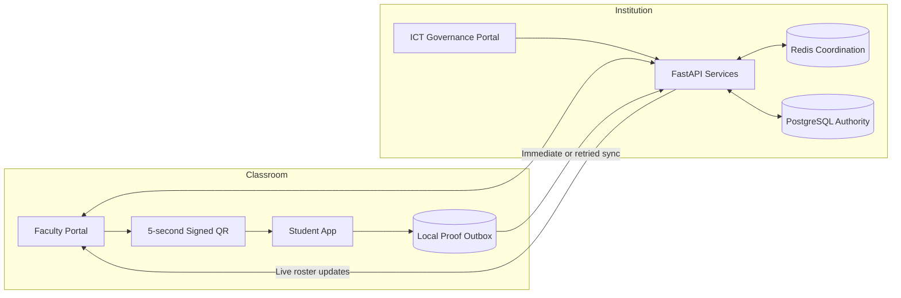
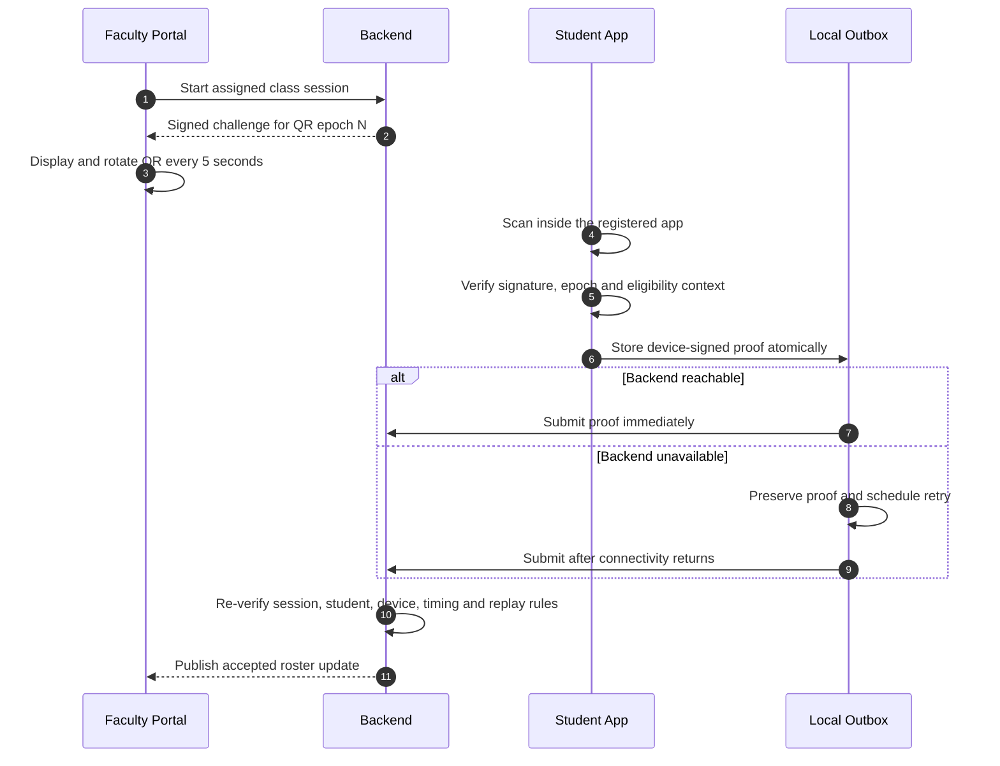
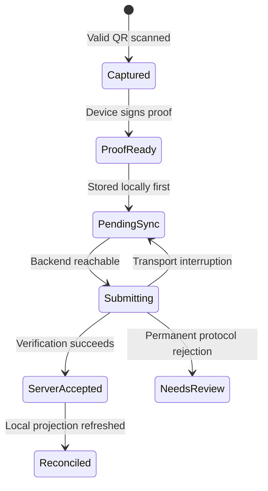
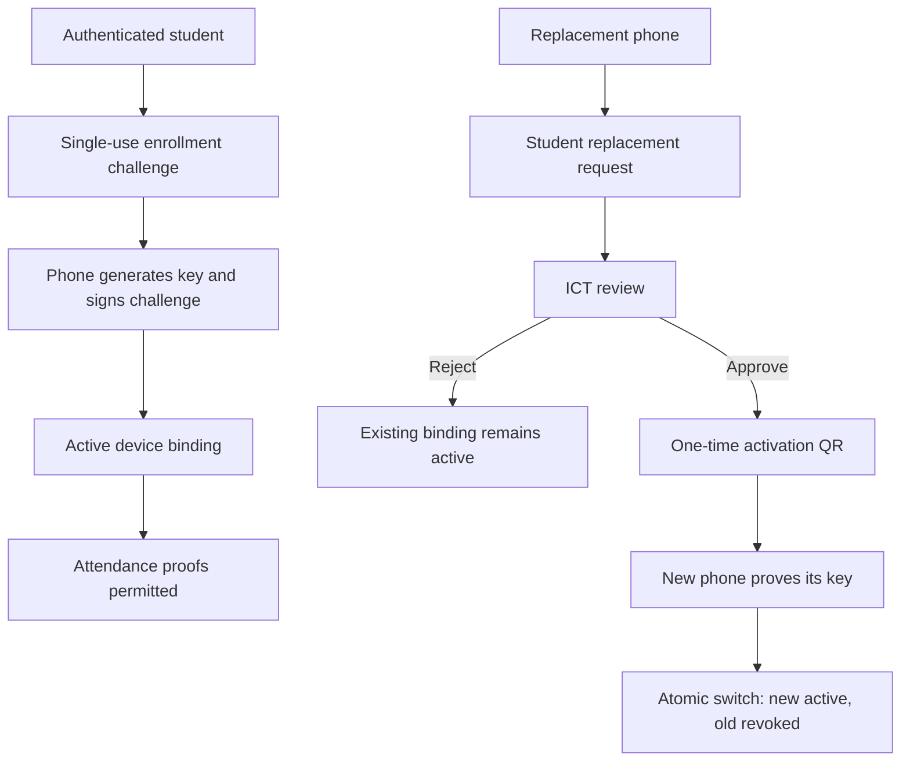

<div align="center">


# OfflineQR Attendance

### Dynamic QR Based Offline Attendance System for Institutions

[](https://github.com/InsaneCoder789/offlineqr-attendance/actions/workflows/backend-tests.yml)
[](https://github.com/InsaneCoder789/offlineqr-attendance/actions/workflows/database-contract.yml)
[](https://github.com/InsaneCoder789/offlineqr-attendance/actions/workflows/faculty-build.yml)
[](https://github.com/InsaneCoder789/offlineqr-attendance/actions/workflows/mobile-tests.yml)
[](https://github.com/InsaneCoder789/offlineqr-attendance/actions/workflows/android-build.yml)

**Capture locally. Sign on the registered device. Synchronize when reachable. Verify centrally.**

</div>

## What It Is

OfflineQR is being developed as a customizable institutional attendance product. The public editorial website lives at `/`; faculty and administrator workspaces retain their dedicated routes. The editorial-only deployment is available at [offlineqr-editorial.vercel.app](https://offlineqr-editorial.vercel.app/). Its deployment planner submits customer-entered details to a server-side PDF generator and downloads a branded proposal/pro forma document. Proposal data is not persisted or emailed by this endpoint, and downloading a PDF does not place an order or confirm payment.

The repository is institution-neutral. Development fixtures use fictional names, clearly synthetic student identifiers and `example.edu` sample identities; these are not official staff or student records. Configure `INSTITUTION_EMAIL_DOMAINS` privately for each authorized deployment, and provision accounts explicitly. Mobile service shortcuts use `ACADEMIC_PORTAL_URL` and `LEARNING_PORTAL_URL` build settings and accept HTTPS URLs only.

## Data And Branding Policy

- Do not commit institutional rosters, official email directories, student records, real phone numbers, payment records or customer credentials.
- Use synthetic fixtures for demos and tests. Any resemblance between a fictional name and a real person is coincidental.
- Keep customer domains, authorized logos, imported spreadsheets, database exports and device captures outside the public source tree.
- Generated customer PDFs and confidential operational artifacts are excluded from Git and from the editorial deployment's file allowlist.
- Vercel Analytics records page views, with URL parameters and fragments redacted. Proposal fields are not sent as analytics events.
- Current-file anonymization does not erase previous Git commits, published releases, deployed copies or externally shared documents. Review those separately before distributing the repository.

The current architecture supports an institution-specific deployment. Shared SaaS tenancy, tenant-scoped database authorization, commercial module entitlements, subscription billing, customer provisioning and production delivery are pending. A configurable email domain is not tenant isolation.

OfflineQR Attendance is an offline-first attendance ecosystem for educational institutions. It combines a Flutter student application, a Next.js faculty portal, an ICT device-governance console, and a FastAPI backend backed by PostgreSQL and Redis.

The classroom workflow does not stop when Internet access disappears. A student can scan a valid classroom QR, create a device-signed proof, and preserve it in a durable local outbox. When connectivity returns, the backend re-verifies the proof and the faculty roster reflects the accepted attendance.

The system is designed to be **proxy-resistant, device-bound, tamper-evident, auditable, and resilient**. It does not claim that software can prevent physical collusion when one student deliberately hands another student their registered phone.

## Product Surfaces

| Surface | Purpose | Core capabilities |
| --- | --- | --- |
| Student app | Capture and understand attendance | Timetable, course attendance, secure in-app scanner, offline logger, device status, Institution portal shortcuts |
| Faculty portal | Operate classroom sessions | Today's classes, dynamic QR, live roster, projector mode, manual attestation, records and reconciliation |
| ICT portal | Govern identity and devices | Device inventory, replacement approval, one-time activation, revocation, password recovery and audit history |
| Backend | Enforce institutional truth | Authentication, eligibility, signatures, duplicates, session lifecycle, synchronization and reporting |

## System Architecture



### Technology Stack

| Layer | Technology |
| --- | --- |
| Mobile | Flutter, Dart, SQLite, platform secure storage |
| Faculty and ICT web | Next.js App Router, React, TypeScript |
| API | FastAPI, Python |
| Durable authority | PostgreSQL |
| Shared coordination | Redis |
| Cryptography | Ed25519 signatures, Argon2id password hashing |
| Delivery | Docker, GHCR, independent GitHub Actions workflows |

## Attendance Protocol



### Timing Model

- The classroom QR changes every **5 seconds**.
- The QR must be scanned during its valid epoch; an unscanned stale image expires.
- A valid scan establishes a bounded **60-second claim window** so signing and durable storage do not need to finish inside five seconds.
- The QR contains session challenge data, never public student identity data.
- The backend enforces one attendance result per `(session, student)` and one active student identity per registered attendance device.
- Canonical UTC serialization is shared across Dart, TypeScript, and Python to prevent signature drift.

## Offline-First Reconciliation



The student app keeps synchronized academic data, attendance records, scan history, signed proofs, and a durable outbox locally. Foreground connectivity polling prioritizes pending attendance proofs as soon as the backend becomes reachable. Retries use bounded backoff and idempotent proof identifiers.

A faculty member may close the visible classroom session before an offline student reconnects. The backend can still accept a proof captured during the valid signed-QR window; session closure does not erase valid evidence created earlier.

## Device-Bound Identity

Each student account may have one active attendance device. Enrollment generates an Ed25519 key pair on the phone, retains the private credential in platform secure storage, and registers only the public credential and privacy-minimized device facts with the backend.



The replacement approval alone does not revoke the working phone. Revocation occurs atomically only after the approved activation is consumed by the new device. Activation tokens are short-lived, single-use, hashed at rest, and audited.

The registry deliberately avoids MAC addresses, IMEI, advertising identifiers, serial numbers, and precise GPS location. Manufacturer, model, platform, OS version, and emulator declaration are review signals rather than cryptographic identity. Production device-integrity enforcement still requires Play Integrity and Apple App Attest or DeviceCheck.

## Faculty Operations

The faculty portal is organized into dedicated routes rather than one oversized client page:

- **Dashboard:** today's teaching plan, next class, quick attendance start, completed sessions, and synchronization state.
- **My Classes:** assigned course offerings and section context.
- **Live Attendance:** signed rotating QR, countdown, present count, searchable roster, attestation, and session controls.
- **Projector Mode:** high-contrast classroom QR presentation without administrative clutter.
- **Records:** course and session history, attendance registers, reconciliation state, and risk visibility.
- **Settings:** faculty profile and controlled credential change.

Faculty access is scoped at the API and database boundary. Real institutional use requires an authoritative faculty-course-section assignment import; the repository's seeded identities are development data only.

## Security Boundaries

- Argon2id password hashes, failed-login lockout, forced initial password change, and server-managed sessions.
- Opaque student and faculty sessions stored in Redis with revocation after credential changes.
- CSRF validation and HTTP-only session handling for browser operations.
- Ed25519 signatures for attendance-device enrollment and attendance proofs.
- Server-side course, section, session, roster, device and duplicate validation.
- Redis-backed distributed request limits and shared session coordination across API workers.
- PostgreSQL uniqueness constraints and append-oriented audit events for authoritative actions.
- QR replay, stale epoch, revoked device, wrong enrollment and duplicate proof rejection.
- No passwords, private keys, confidential spreadsheets or onboarding registers committed to Git.

## Repository Layout

```text
backend/                 FastAPI routes, domain services and security controls
backend/migrations/      PostgreSQL schema and lifecycle migrations
backend/tests/           API, protocol, database, identity and device tests
client/                  Flutter student app and offline-first local store
faculty-portal/          Next.js faculty and ICT portal
shared/fixtures/         Cross-platform cryptographic protocol vectors
scripts/                 Database, import and verification utilities
.github/workflows/       Ten independent CI checks and release publishing
assets/                  Public repository artwork
deploy/editorial/        Isolated editorial website and proposal PDF endpoint
```

## Local Development

### Prerequisites

- PostgreSQL 16
- Redis 7
- Python 3.11
- Node.js 22
- Flutter 3.47.2

### 1. Prepare the Database

```bash
export DATABASE_URL=postgresql://localhost/offlineqr_attendance_goal02
./scripts/db_reset.sh
```

This command applies the migrations and development seed. Do not use the reset script against an institutional or production database.

### 2. Start the Backend

```bash
source .venv/bin/activate
uvicorn backend.app.main:app --reload --host 0.0.0.0 --port 8000
```

Set `REDIS_URL` and use `REDIS_REQUIRED=true` whenever distributed coordination is required.

### 3. Start the Faculty Portal

```bash
cd faculty-portal
npm ci
npm run dev
```

Open `http://127.0.0.1:5173`.

### 4. Start the Student App

```bash
cd client
flutter pub get
flutter run --dart-define=API_BASE_URL=http://YOUR_HOST:8000
```

Use `http://10.0.2.2:8000` from the Android emulator. A physical phone must use the development machine's reachable LAN address; `127.0.0.1` on the phone refers to the phone itself.

## Independent Quality Gates

GitHub displays each boundary as a separate workflow, so one failure cannot hide unrelated results behind a skipped job.

| Workflow | Boundary |
| --- | --- |
| Backend Tests | FastAPI protocol and service behavior with PostgreSQL and Redis |
| Database Contract | Migrations, seed integrity, constraints and invariants |
| Backend Security Audit | Python dependency vulnerability audit |
| Faculty Portal Tests | React and portal unit tests |
| Faculty Portal Build | TypeScript and production Next.js build |
| Faculty Dependency Audit | Production npm vulnerability audit |
| Mobile Static Analysis | Dart analyzer with fatal informational findings |
| Mobile Unit Tests | Flutter protocol, persistence, sync and UI tests |
| Android Debug Build | Backward-compatible Android APK compilation |
| Container Build Verification | Backend and faculty portal production images |

Tags matching `v*` run the separate release workflow and publish container images to GHCR.

## Institutional Deployment Checklist

Before a real campus rollout, the institution must provide and approve:

1. Institution OIDC or SAML identity integration, MFA policy, recovery controls and role claims.
2. Authoritative student, faculty, course, section, room, timetable and enrollment feeds.
3. Android Play Integrity and Apple App Attest or DeviceCheck enforcement.
4. Managed PostgreSQL and Redis with TLS, credentials, backups, failover and monitoring.
5. HTTPS termination, permitted origins, secret rotation and migration operations.
6. Background synchronization policies tested on supported Android and iOS versions.
7. Physical-device end-to-end testing across offline capture, reconnection and late reconciliation.
8. Accessibility review, retention/deletion rules, incident response and institutional security approval.

## Project Principle

> Capture locally. Verify cryptographically. Store durably. Synchronize eventually. Re-verify centrally. Keep faculty as the controlled human fallback.
